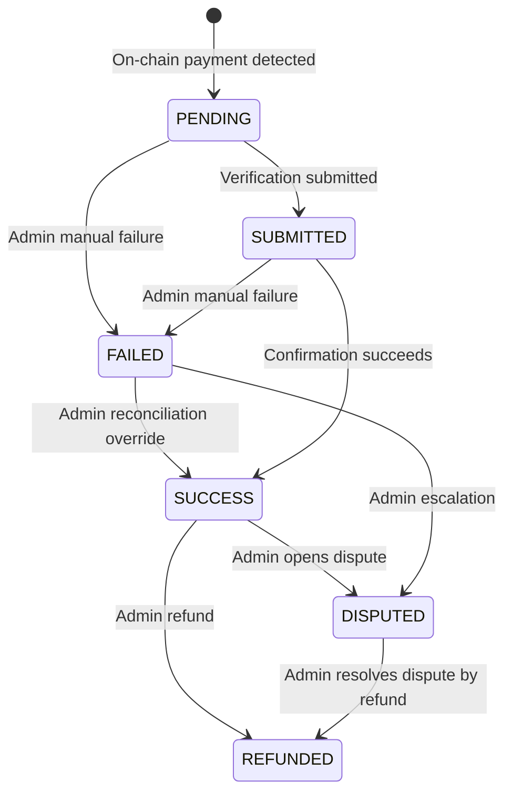

# Payment State Machine

This document describes the canonical payment status transitions enforced by
`backend/src/constants/paymentStatus.js` and
`backend/src/models/paymentModel.js`.

The model-level guard rejects illegal status changes with `INVALID_TRANSITION`
and returns a message of the form:
`Payment status transition from <FROM> to <TO> is not allowed`.

## Status diagram

> `PENDING --> SUBMITTED` and `SUBMITTED --> SUCCESS` are implemented as
> pipeline state changes and are idempotent; they are not listed in the
> persisted-status guard because that guard is deliberately restricted to
> externally permitted manual corrections.

## State descriptions

| State | Meaning | Typical trigger | Actor |
|---|---|---|---|
| `PENDING` | Payment is detected or awaiting processing. | Horizon poller detects a matching transaction. | Horizon event / system |
| `SUBMITTED` | Payment verification has been submitted for processing. | Verification queue accepts the transaction. | System / queue worker |
| `SUCCESS` | Payment is confirmed and matched to a student. | Stellar confirmation plus successful reconciliation. | Horizon event / system |
| `FAILED` | Payment cannot be completed or was manually failed. | Verification failure or stuck-payment reconciliation. | System or admin |
| `DISPUTED` | A confirmed or previously failed payment is under investigation. | Admin or parent-initiated dispute. | Admin / user |
| `REFUNDED` | Funds have been refunded. | Refund service completes an approved refund. | Admin / system |
| `INVALID` | Payment is structurally invalid. | Missing memo or another structural validation failure. | Horizon event / system |

## Valid persisted transitions

| From | To | Required path |
|---|---|---|
| `PENDING` | `FAILED` | Normal manual reconciliation |
| `SUBMITTED` | `FAILED` | Normal manual reconciliation |
| `SUCCESS` | `DISPUTED` | Normal admin/user dispute path |
| `SUCCESS` | `REFUNDED` | Normal refund path |
| `DISPUTED` | `REFUNDED` | Admin override; audited explicitly |
| `FAILED` | `SUCCESS` | Admin override after manual reconciliation |
| `FAILED` | `DISPUTED` | Admin override for investigation |

The wider admin transitions require
`payment.$locals.adminOverride = true` and must be captured in the audit log by
the caller.

## Invalid transitions and idempotency

An invalid status change throws `INVALID_TRANSITION`. It is the caller's
responsibility to return or surface this error instead of persisting partial
data.

Saving a document whose status did not change is an idempotent no-op. Repeating
an already completed transition does not perform it a second time; callers
should check the current state before applying side effects. Duplicate payment
verification is also guarded by the payment idempotency key and transaction hash.

Examples of invalid transitions:

- `FAILED -> PENDING`
- `FAILED -> REFUNDED`
- `SUCCESS -> FAILED`
- `DISPUTED -> PENDING`
- `DISPUTED -> REFUNDED` without an admin override
- `REFUNDED -> SUCCESS`

## External triggers

| Transition | Trigger | Actor |
|---|---|---|
| Detected -> `PENDING` | Horizon payment event or transaction poll | Horizon / system |
| `PENDING` -> `SUBMITTED` | Queue verification starts | Queue worker |
| `SUBMITTED` -> `SUCCESS` | Stellar confirmation and student matching | Horizon / system |
| Any non-terminal state -> `FAILED` | Validation or verification failure | Horizon / system |
| `SUCCESS` -> `DISPUTED` | Dispute is opened | Admin / parent |
| `SUCCESS` / `DISPUTED` -> `REFUNDED` | Refund is approved and completed | Admin / refund system |

## Test coverage

- Persisted status transitions:
  [`tests/paymentModelTransition.test.js`](../../tests/paymentModelTransition.test.js)
- Submitted and polling transitions:
  [`tests/submittedStatusTransitions.test.js`](../../tests/submittedStatusTransitions.test.js)
